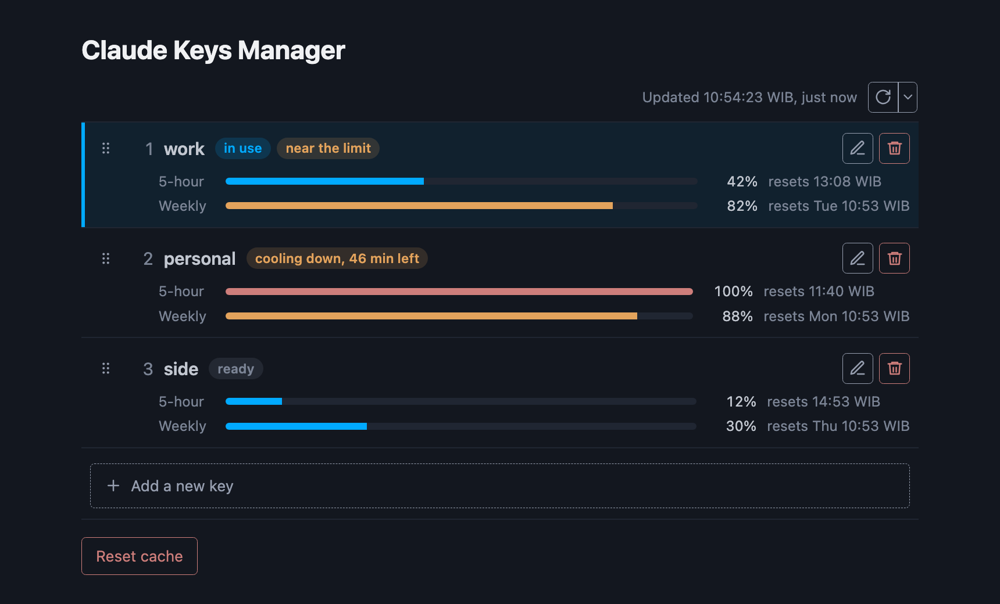
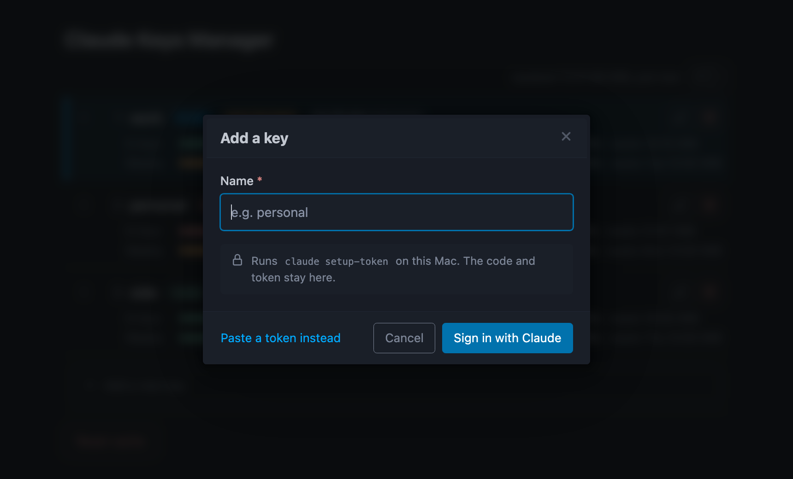
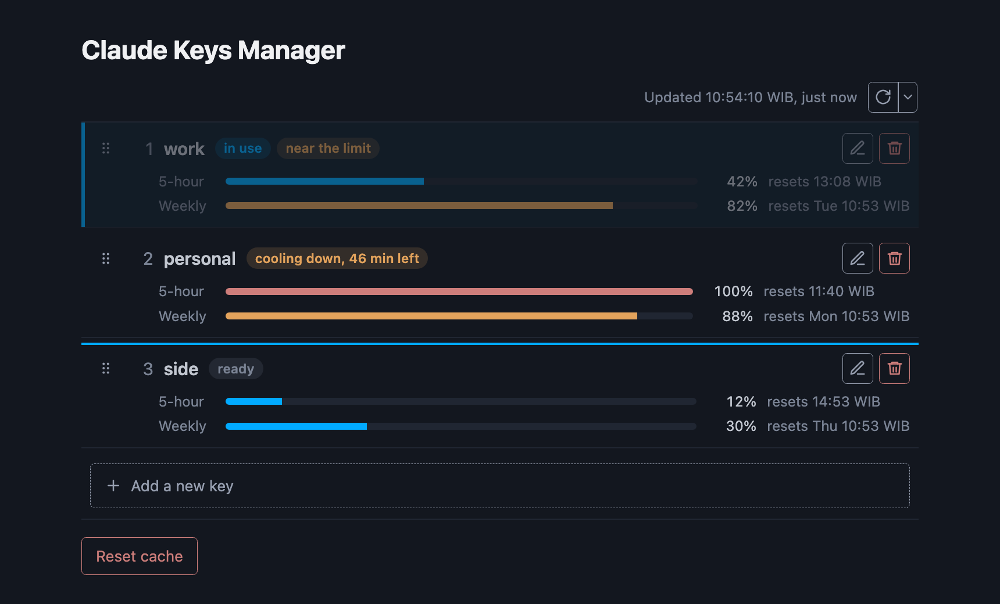
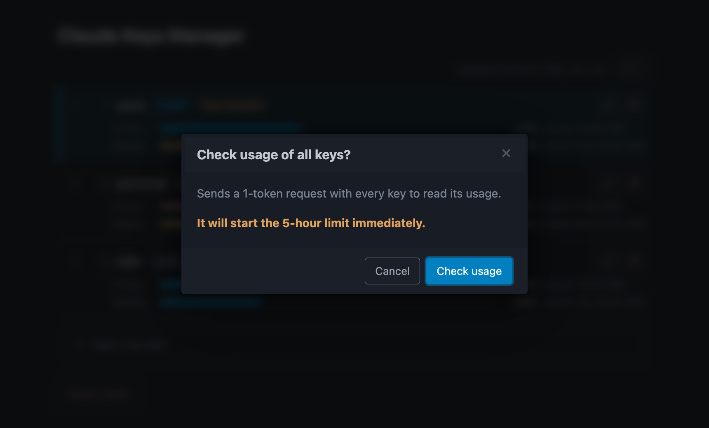
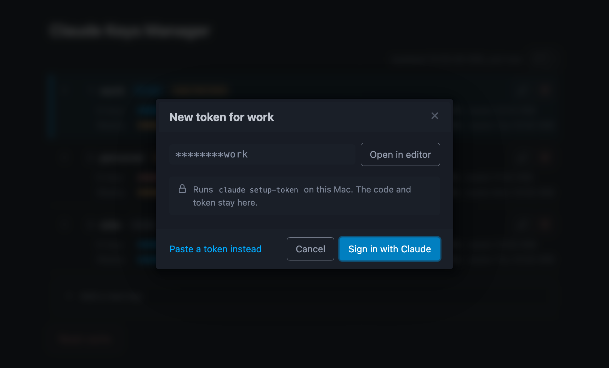
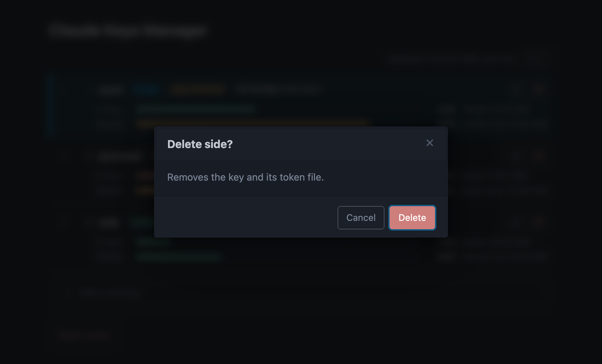

<h1 align="center">Claude KeyProxy</h1>

<p align="center">Use several Claude subscriptions in one Claude Code session.</p>

<p align="center">
  
  
</p>

<p align="center"></p>

* * *

## What is Claude KeyProxy?

It manages several Claude subscriptions for Claude Code. When one subscription hits its usage limit, it automatically moves to the next available token without a restart or a new login.

## Features

- **Automatic failover.** When a key hits its limit, the same request moves to the next key in the same session.
- **Key manager page.** Add a key by signing in with Claude in the browser, without a terminal.
- **Turn a key off.** The proxy skips a disabled key until you turn it back on.
- **Usage at a glance.** See the 5-hour and weekly usage of each key, and which key is in use.
- **Agent tools.** An MCP server lets an agent manage the keys for you.
- **Zero dependencies.** Python standard library only.

## Screenshots

<table>
<tr>
<td width="50%"><a href="docs/sign-in.png"></a><br>Add a key by signing in with Claude.</td>
<td width="50%"><a href="docs/reorder.png"></a><br>Drag a key to change which one is tried first.</td>
</tr>
<tr>
<td width="50%"><a href="docs/check-usage.png"></a><br>Check the usage of every key.</td>
<td width="50%"><a href="docs/replace.png"></a><br>Update a key's token, or open it in your editor.</td>
</tr>
<tr>
<td width="50%"><a href="docs/delete.png"></a><br>Delete a key and its token file.</td>
<td></td>
</tr>
</table>

## Installation

### Install with Claude Code

Paste this instruction into Claude Code.

```
Install claude-keyproxy from https://github.com/JonathanGun/claude-keyproxy. Follow the steps in its AGENTS.md.
```

### Install with uv or pipx

```bash
uv tool install git+https://github.com/JonathanGun/claude-keyproxy
# or: pipx install git+https://github.com/JonathanGun/claude-keyproxy
```

## Quick Start

### Add your keys

1. Start the proxy and open its key manager page.

   ```bash
   keyproxy-up --open
   ```

2. Click **Add a new key**.
3. Click **Sign in with Claude**, sign in with the account for this key, and paste the code back.
4. Repeat for each account.

### Headless

1. Make one token per account with `claude setup-token`.
2. Save each token in its own file and list the files in `index.json`. [`examples/index.json`](examples/index.json) shows the shape.

   ```bash
   mkdir -p ~/.config/claude/keys
   $EDITOR ~/.config/claude/index.json ~/.config/claude/keys/work.key ~/.config/claude/keys/personal.key
   ```

### Run Claude Code through the proxy

```bash
claude-keyproxy
```

## Applying KeyProxy by default on `claude`

Add this to your shell startup file, for example `~/.zshrc` for zsh or `~/.bashrc` for bash:

```sh
export ANTHROPIC_BASE_URL=http://127.0.0.1:18787
claude() { keyproxy-up && command claude "$@"; }
```

## MCP Integration

Claude keyproxy comes with MCP server named `keyproxy-mcp`. Add it to Claude Code, and an agent can list, add, reorder, disable and delete keys, and reset the cooldowns:

```bash
claude mcp add keyproxy -- keyproxy-mcp
```

To add a key, the agent gives you a sign-in link and asks for the code, like the page does. The token stays on your machine. An agent can also save a token you paste to it, but that token then stays in the conversation.

## How it works

### Background

- Claude Code sets its account only once, when it starts.
- The 5-hour limit runs out quickly.
- Running `/login` requires an interactive authorization flow.
- A token can be created once with `claude setup-token` and reused for one year.

### Solution

Create a proxy that switches tokens intelligently, then make `claude` send its requests through the proxy.

Each key has priority. It will be used sequentially based on priority. A key that is invalid or rate-limited is skipped until its limit resets, and the same request is retried on the next key. A request that has its own API key is passed through untouched.

The log is at `~/.cache/keyproxy.log`.

## Config

Config is stored in `~/.config/claude/` by default.

```
~/.config/claude/
├── index.json        # keys and their priority, lowest number first
└── keys/
    ├── work.key      # one OAuth token per file
    └── personal.key
```

| Variable | Default | Does |
| --- | --- | --- |
| `KEYPROXY_PORT` | `18787` | port of the proxy and its key manager page, on 127.0.0.1 only |
| `CLAUDE_KEY_INDEX` | `~/.config/claude/index.json` | where the key list is |
| `KEYPROXY_STRATEGY` | `priority` | how a key is chosen, see below |
| `KEYPROXY_HEADLESS` | unset | `1` turns the key manager page off, see below |

## Changing proxy behavior

These options apply when the proxy starts. Restart it after a change:

```bash
keyproxy-up --restart [options]
```

**Run without the page.** `--headless` turns the key manager off. Keys are then changed only by editing the files, as in the Headless steps. The proxy still serves the read-only status calls.

```bash
keyproxy-up --restart --headless
```

**Choose how keys are picked.** A strategy decides which keys a request tries, and in what order. The default, `priority`, tries the ready keys from the lowest priority number up. A strategy is a file in `src/claude_keyproxy/strategies/`, and `--strategy` takes its file name:

```bash
keyproxy-up --restart --strategy priority
```

To write your own, clone the repo and install it with `make install`, which installs the clone in editable mode. Then add a file next to `priority.py` with one function. It gets every usable key and returns the ones to try, in order:

```python
def choose(keys, cooldowns):
    """keys: Key(name, token, priority). cooldowns.left(name): seconds until a key is ready, 0 if it is."""
    ready = [key for key in keys if cooldowns.left(key.name) == 0]
    return ready or keys
```

`src/claude_keyproxy/strategies/__init__.py` has the full contract.

## Limitations

- **Experimental Anthropic feature.** OAuth tokens work on the API only with the `anthropic-beta: oauth-2025-04-20` header. Claude Code sends it, and the proxy adds it when a client does not. It is not a documented interface, so it may change or break at any time.
- **Usage comes with a request.** Anthropic reports a key's usage only in its responses, so a new key shows none at first. **Check usage of all keys**, in the menu next to the refresh button, sends a 1-token request with every key. This starts the 5-hour window of an account that is not in one yet.
- **Cold cache after a switch.** Cached prompts belong to the account that made them. The first request on the next key starts without a cache.
- **No retry mid-stream.** A request moves to another key only before the response starts. A stream that fails halfway is not retried.
- **No login on the proxy.** Any process on your machine can use your keys through port 18787.
- **Anthropic's terms.** Rotating accounts to get around usage limits may go against them. Check the terms for your accounts before you use it.

## Contributing

Issues and pull requests are welcome. [AGENTS.md](AGENTS.md) has the layout, the rules and how to run the tests.

## License

MIT, see [`LICENSE`](LICENSE).
