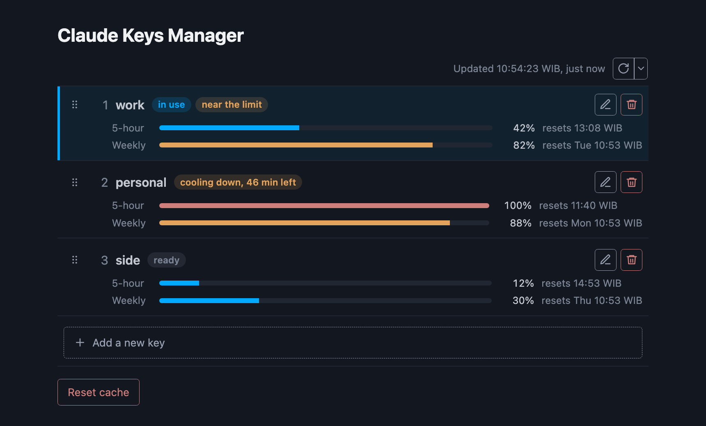
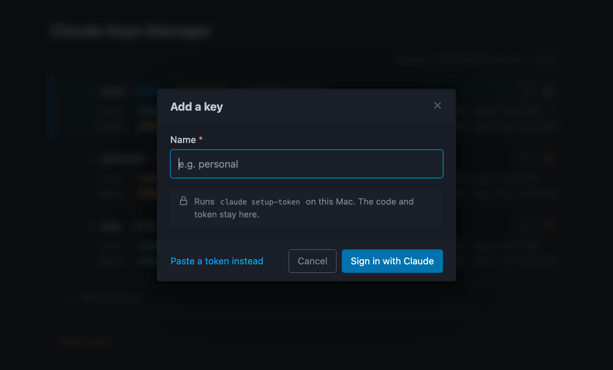
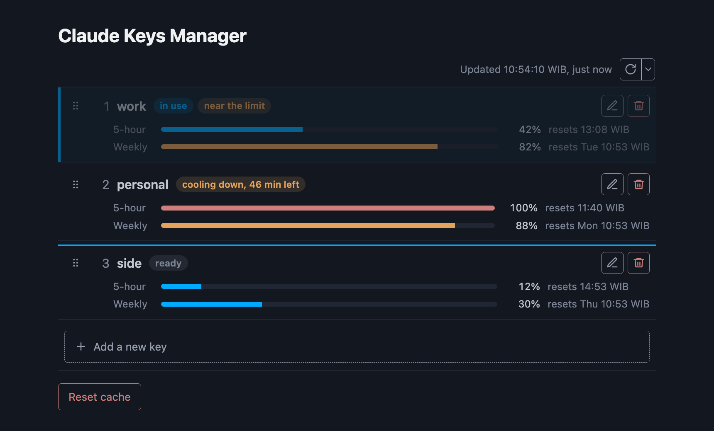
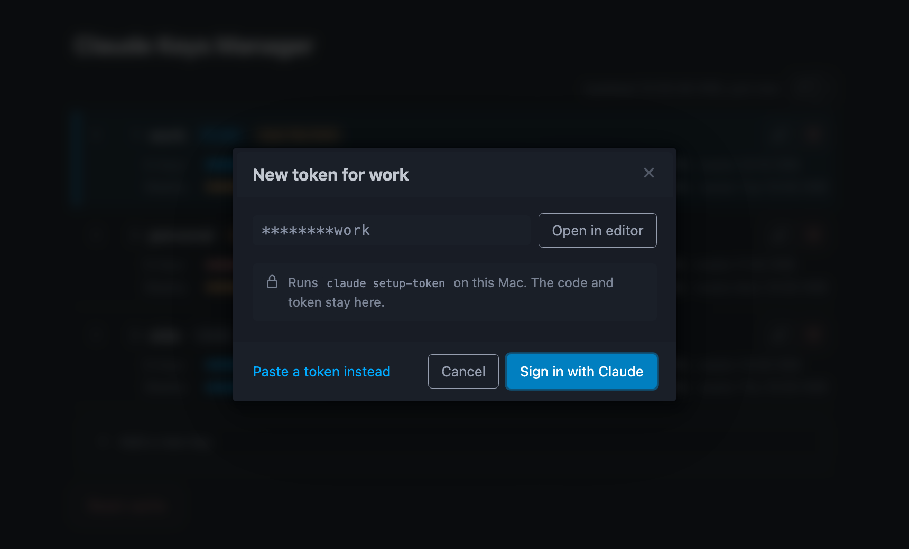
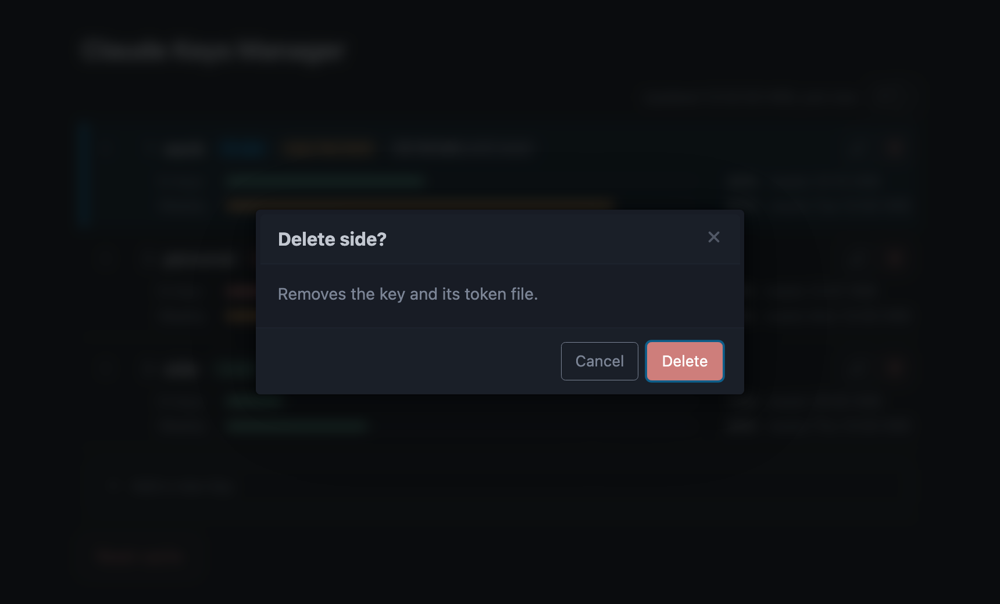
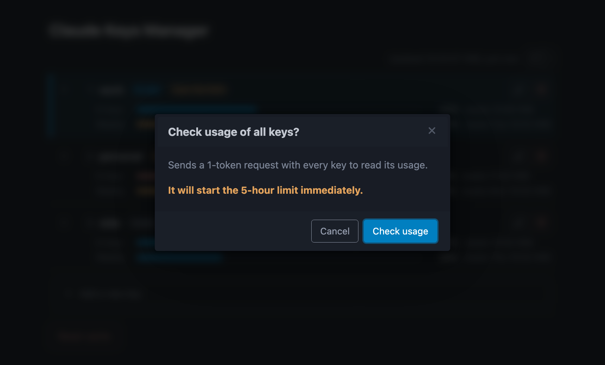

# Claude KeyProxy Guide

This guide explains how the proxy picks a key, how it handles a limited key, and how to use the key manager page. Install steps and the config files are in the [README](../README.md).

## What the proxy does

Claude KeyProxy is a local HTTP server on `127.0.0.1:18787`. Claude Code sends its requests to it through `ANTHROPIC_BASE_URL`. The proxy drops the token Claude Code sent, puts in one of your keys, and forwards the request to `https://api.anthropic.com`.

The same port serves the key manager page at `/` and its API under `/_keyproxy/`. Nothing under those paths goes upstream.

A request with an `x-api-key` header and no `Authorization` header is API key traffic. The proxy forwards it as it is, with its own key.

## Key rotation

The proxy reads `index.json` and the token files again on every request. Therefore, a key added, reordered or turned off on the page applies from the next request, without a restart.

For each request:

1. The proxy takes every key that is turned on and has a readable token file.
2. The strategy picks which of them to try, in order. The default `priority` strategy gives the ready keys, lowest priority number first.
3. The proxy sends the request with the first key.
4. If that key is limited or rejected, the proxy cools it down and sends the same request with the next key.
5. The first answer that is not limited or rejected goes back to Claude Code as it is, streamed.

A key counts as limited when Anthropic answers `429`, or when the `anthropic-ratelimit-unified-status` header says `rejected`. A key counts as rejected when Anthropic answers `401`.

The last key in the list is never skipped. If it is limited too, its error goes back to Claude Code. If no key is usable, the proxy answers `503 no keys available`.

A network error on one key also moves the request to the next key. On the last key it becomes a `502`.

## Cooldown

A cooled key is skipped until its cooldown ends. The proxy takes the end time from the response, in this order:

| Source | Cooldown ends |
| --- | --- |
| `anthropic-ratelimit-unified-reset` header | at that time |
| `retry-after` header | after that many seconds |
| neither, the key is limited | after 5 minutes |
| neither, the token was rejected (`401`) | after 10 minutes |

When every key is cooling down, the `priority` strategy still tries one key: the one whose cooldown ends first. Therefore, a request never fails only because every key is cooling.

Cooldowns and usage live in the proxy's memory. A restart forgets them, and every key starts as ready. **Reset cache** on the page does the same without a restart.

## Key manager page

Open it with `keyproxy-up --open`, or go to http://127.0.0.1:18787/. It answers only requests whose host is `127.0.0.1` or `localhost` on the proxy's port. Therefore, another website cannot read or change your keys.

<p align="center"></p>

Each row is one key, in priority order. The number on the left is its position. Keys are saved under `~/.config/claude/`: the list in `index.json`, and each token in `keys/<name>.key` with mode 600. The page and its API show only the last 4 characters of a token.

### Status chips

| Chip | Means |
| --- | --- |
| in use | the first key that is on, has a token file and is not cooling down. The next request goes to it |
| ready | usable, behind the key in use |
| near the limit | Anthropic sent `allowed_warning` for this key |
| rate limited | cooling down after a limit |
| cooling down | cooling down after its token was rejected |
| disabled | turned off on the page |
| key file missing | the token file listed in `index.json` cannot be read |
| _time_ until reset | for a cooling key, the cooldown left. Otherwise, the time until its 5-hour window resets |

### Usage

Each key shows two bars: **5-hour** and **Weekly**. Each bar has the percent used and when that window resets. A bar turns orange from 80% and red from 95%.

The numbers come from the `anthropic-ratelimit-unified-5h-*` and `-7d-*` headers on the key's last response. Some keys show a note in place of the bars:

| Note | Means |
| --- | --- |
| No requests yet. | the key has not answered a request since the proxy started |
| API key, no quota. | the token is an API key |
| Not a subscription key | the answer had no 5-hour or weekly window |

When a window's reset time has passed, the bar shows 0% until the key answers again. Times on the page are in WIB (UTC+7).

The page refreshes every 3 minutes while its tab is visible and focused. When you come back to the tab, it refreshes at once if the last refresh was over a minute ago. The refresh button at the top refreshes now.

On a narrow screen each key folds into one line, such as `5h 42% · 7d 82%`. Tap the row to open its bars.

### Add a key

<p align="center"></p>

1. Click **Add a new key** and give it a name. A name may use letters, digits, `.`, `_` and `-`.
2. Click **Sign in with Claude**. The proxy runs `claude setup-token` on your machine and shows its sign-in link.
3. Click **Open the sign-in page**, sign in with the account for this key, and copy the code.
4. Paste the code and click **Save key**. The proxy hands the code to `claude` and saves the token it returns.

The new key goes to the bottom of the list. Only one sign-in can be open at a time. Closing the dialog stops it, and a wrong code ends it, so start again.

If you already have a token from `claude setup-token`, click **Paste a token instead**.

### Reorder keys

<p align="center"></p>

Drag a key onto another row to take its place. With a mouse you can grab anywhere on the row. On a touch screen, drag the handle on the left. With a keyboard, focus the handle and press the up or down arrow.

The order sets the priority, 1 for the top row. The next request follows the new order.

### Replace a token

<p align="center"></p>

Click the pencil button on a row to give that key a new token, for example when its token expired. The dialog shows the current token masked down to its last 4 characters.

Sign in with Claude again, or paste a token. **Open in editor** opens the token file in your default text editor, with `open -t` on macOS and `xdg-open` on Linux. The token itself never goes through the page.

### Turn a key off

Click the power button on a row. The proxy skips a disabled key until you click it again. The setting is saved in `index.json` as `"disabled": true`, so it stays across restarts.

Turning a key off also clears its cooldown and its usage, so the row shows only "disabled".

### Delete a key

<p align="center"></p>

Click the red bin button and confirm. The key leaves `index.json`, the keys below it move up, and its token file is deleted.

### Check usage of all keys

<p align="center"></p>

Open the menu next to the refresh button and click **Check usage of all keys**. After you confirm, the proxy sends a 1-token request with every subscription key that is on, all at once. It reads the usage from the answers.

This request starts the 5-hour window of an account that is not in one yet. A key that answers with a limit is cooled down, as with any other request.

If the dialog says the running proxy is older than the page, restart it with `keyproxy-up --restart`.

### Reset cache

**Reset cache** at the bottom clears every cooldown and the usage seen, after a confirmation. Every key shows as ready, and the bars show "No requests yet." until each key answers again.

## Setup

Install the package and add your keys as the [README](../README.md#installation) shows. These are the parts of setup it does not cover.

### Start and restart

`keyproxy-up` starts the proxy in the background if nothing answers on its port, and does nothing otherwise. It is safe to run before every `claude`, which is what the shell function in the README does.

```bash
keyproxy-up                        # start if it is down
keyproxy-up --open                 # also open the key manager page
keyproxy-up --restart              # stop the running proxy and start a new one
keyproxy-up --restart --headless   # restart without the page
```

Options such as `--headless` and `--strategy` apply only when the proxy starts. Use `--restart` after an upgrade or an option change. A restart needs `lsof` to find the running proxy.

To run it in the foreground instead, for example to watch the log, run `keyproxy`.

### How `claude-keyproxy` runs Claude Code

`claude-keyproxy` starts the proxy if needed, then runs `claude` with every argument you give it. It sets `ANTHROPIC_BASE_URL` to the proxy, removes `ANTHROPIC_API_KEY`, and sets `CLAUDE_CODE_OAUTH_TOKEN` to a placeholder. Therefore, Claude Code starts without a login of its own.

### Check that it runs

```bash
curl -s http://127.0.0.1:18787/_keyproxy/api/cache   # {} when no key is cooling down
curl -s http://127.0.0.1:18787/_keyproxy/api/keys    # the keys, with the last 4 characters of each token
```

The log is `~/.cache/keyproxy.log`, or `$XDG_CACHE_HOME/keyproxy.log` when that is set. Each request logs the key it used, and each skip logs the cooldown, for example `skip personal for 2820s, next key`.
